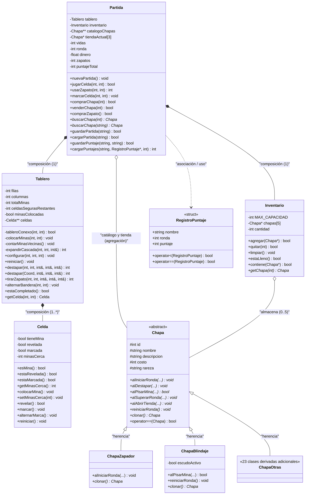

# 💣 Dot-Dot-Boom — Rogue-Minesweeper

**Proyecto Final de Programación Orientada a Objetos (Semestre 2026-II)**  
*Escuela Profesional de Ciencia de la Computación — Segundo Semestre*

---

## 🎮 1. Descripción del Videojuego

**Dot-Dot-Boom** es una reinvención estratégica del clásico **Buscaminas (Minesweeper)** combinada con mecánicas modernas de **Roguelike y Deckbuilding de Reliquias** (inspirado en dinámicas como las de *Balatro* y *DemonCrawl*).

### 🎯 Mecánicas Principales
* **Progresión por Rondas:** 10 rondas de combate. El tablero crece dinámicamente desde 5×5 (7 minas) hasta 23×23 (25 minas), aumentando el desafío táctico.
* **Sistema de Vidas y Puntuación:** El jugador comienza con 3 vidas. Cada casilla revelada otorga puntos y monedas proporcionales al riesgo (más monedas si la celda tiene múltiples minas adyacentes).
* **El Zapato Táctico:** Herramienta consumible que permite inspeccionar una celda a distancia: si había una bomba la desactiva sin perder vidas revelando el área 3×3; si estaba limpia, abre la zona con seguridad.
* **Sistema de Chapas (Reliquias Polimórficas):** 25 chapas coleccionables divididas en cuatro rarezas (*Común*, *Rara*, *Épica*, *Legendaria*). Modifican las reglas del juego en tiempo de ejecución (escudos de daño, bonos de dinero, curaciones, zapatos automáticos, etc.).
* **Tienda Táctica:** Se habilita cada vez que el jugador destapa 5 casillas seguras. Permite comprar provisiones (zapatos y nuevas chapas) o vender chapas equipadas para recuperar el 50% de su valor.
* **Persistencia Doble:**
  * Guardado y recuperación completa de partidas (`partida.txt`).
  * Salón de la Fama y Ranking de mejores puntuaciones (`scores.txt`).

---

## 🚀 2. Instrucciones de Compilación y Ejecución

### Requisitos Previos
* Compilador de C++ con soporte para **C++20** (por ejemplo, MinGW-w64 GCC 14.2.0 o CodeBlocks).
* Librería multimedia **SFML 3.1.0** (64-bit para MinGW).

### Opción A: Modo Gráfico SFML (Recomendada)
Para compilar y lanzar el videojuego con interfaz gráfica completa:
```cmd
compilar.bat
```
*(Si solo deseas compilar sin ejecutar automáticamente, corre `compilar.bat nojugar`)*.

### Opción B: Modo Consola (Terminal / Pruebas de Laboratorio)
Si deseas ejecutar la versión de terminal para verificar la lógica pura y el motor orientado a objetos sin entorno gráfico:
```cmd
probar.bat
```

### Opción C: Compilación Manual por Terminal (G++)
```cmd
g++ -std=c++20 Celda.cpp Chapa.cpp Inventario.cpp Tablero.cpp Partida.cpp main.cpp -o src\DotDotBoom.exe -I"%USERPROFILE%\tools\SFML-3.1.0\include" -L"%USERPROFILE%\tools\SFML-3.1.0\lib" -lsfml-graphics -lsfml-window -lsfml-system -lsfml-audio
```

---

## 📋 3. Cumplimiento de la Rúbrica de Evaluación (20 Puntos)

| Criterio | Puntos | Implementación y Justificación en el Código |
| :--- | :---: | :--- |
| **3.1 Diseño de Clases y UML** | **2.0** | Responsabilidades modulares y cohesivas: `Celda` (átomo), `Tablero` (matriz y conectividad), `Chapa` (estrategia polimórfica), `Inventario` (colección limitada), `Partida` (orquestador de reglas). Diagrama UML consistente. |
| **3.2 Composición, Agregación y Asociación** | **2.0** | **Composición:** `Partida` compone a `Tablero` e `Inventario` por valor (`Partida.h:25, 39`); `Tablero` compone matriz dinámica de `Celda` (`Tablero.cpp:33`).<br>**Agregación:** `Inventario` y Tienda administran punteros a `Chapa` del catálogo (`Inventario.h:9`, `Partida.h:44`).<br>**Asociación:** `Partida` se asocia con `RegistroPuntaje` para rankings (`Partida.h:71`). |
| **3.3 Encapsulamiento** | **1.5** | Atributos `private:` y `protected:`. Métodos de mutación con validación de rango (ej. `Celda::setMinasCerca` en `Celda.cpp:16` asegura valores entre 0 y 8; `Tablero::configurar` en `Tablero.cpp:27` valida límites dimensionales y tope de minas). |
| **3.4 Herencia y Polimorfismo** | **3.0** | Clase base abstracta pura `Chapa` (`Chapa.h:5`) con método virtual puro `virtual Chapa* clonar() const = 0;` y destructor virtual.<br>**25 clases derivadas** con sobrescritura (`override`). Despacho dinámico (*dynamic dispatch*) en tiempo de ejecución al destapar, pisar minas y cobrar rondas (`Partida.cpp:138, 155, 207`). |
| **3.5 Constructores, Destructores y Recursos** | **2.0** | Constructores parametrizados y por defecto con listas de inicialización. Destructores pertinentes que liberan memoria dinámica (`Tablero::liberar` en `Tablero.cpp:14`, `Inventario::limpiar` en `Inventario.cpp:35`, `Partida::~Partida` en `Partida.cpp:18`). Uso justificado por el crecimiento dinámico del tablero y catálogo polimórfico. |
| **3.6 Sobrecarga** | **1.0** | **Sobrecarga de Métodos:** `Tablero::destapar(int, int)` vs `Tablero::destapar(Coord)` (`Tablero.h:35-36`); `Partida::buscarChapa(int)` vs `Partida::buscarChapa(string)` (`Partida.h:67-68`).<br>**Sobrecarga de Operadores:** `RegistroPuntaje::operator<` y `operator==` (`Partida.h:14-20`); `Chapa::operator==` (`Chapa.cpp:23`). |
| **3.7 Algoritmos y Colecciones** | **2.0** | **Búsqueda en Grafos (BFS):** Algoritmo `tableroConexo` (`Tablero.cpp:54-94`) que verifica mediante una cola si el tablero generado es un componente conexo resoluble.<br>**Ordenamiento:** Algoritmo de ordenamiento por intercambio (`Partida.cpp:302`) para ordenar el Top 10 de puntajes usando `operator<`.<br>**Flood Fill:** Expansión en cascada recursiva (`Tablero.cpp:166`). |
| **3.8 Persistencia de Información** | **2.0** | **Partidas:** `Partida::guardarPartida` y `cargarPartida` serializan y restauran estado completo en `partida.txt` (`Partida.cpp:316, 331`).<br>**Récords:** `Partida::guardarPuntaje` y `cargarPuntajes` en `scores.txt` (`Partida.cpp:274, 284`). |
| **3.9 Funcionalidad y Calidad del Código** | **2.0** | Código limpio, modular, sin fugas de memoria, interfaz visual responsiva en SFML (60 FPS, opciones de pantalla, audio y controles) y modo alternativo para consola. |
| **Total** | **20.0** | **Cumplimiento completo de los requisitos obligatorios.** |

---

## 🏗️ 4. Diagrama de Clases UML



---

## 📁 5. Estructura del Proyecto

```
Dot-Dot-Boom/
├── Celda.h / Celda.cpp         # Representación y estado atómico de celdas
├── Tablero.h / Tablero.cpp     # Matriz dinámica, BFS de conexidad y cascada
├── Chapa.h / Chapa.cpp         # Jerarquía abstracta y 25 reliquias polimórficas
├── Inventario.h / Inventario.cpp # Colección de chapas equipadas (máximo 5)
├── Partida.h / Partida.cpp     # Motor de reglas, economía, tienda y persistencia
├── main.cpp                    # Interfaz gráfica SFML 3, menús, HUD y tienda interactiva
├── test/
│   └── prueba.cpp              # Simulador en consola para pruebas de laboratorio
├── prototipos/
│   └── Jugador.h / Jugador.cpp # Prototipo inicial de avatar deshabilitado
├── compilar.bat                # Script de compilación automática para SFML
├── probar.bat                  # Script de compilación y ejecución en terminal
├── scores.txt                  # Salón de la fama con récords persistidos
├── partida.txt                 # Archivo de guardado de partida en curso
└── README.md                   # Documentación técnica oficial y guía de sustentación
```
